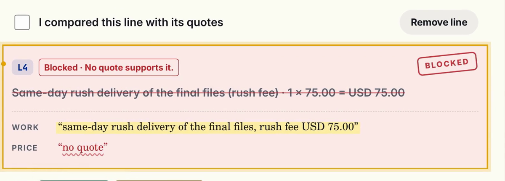
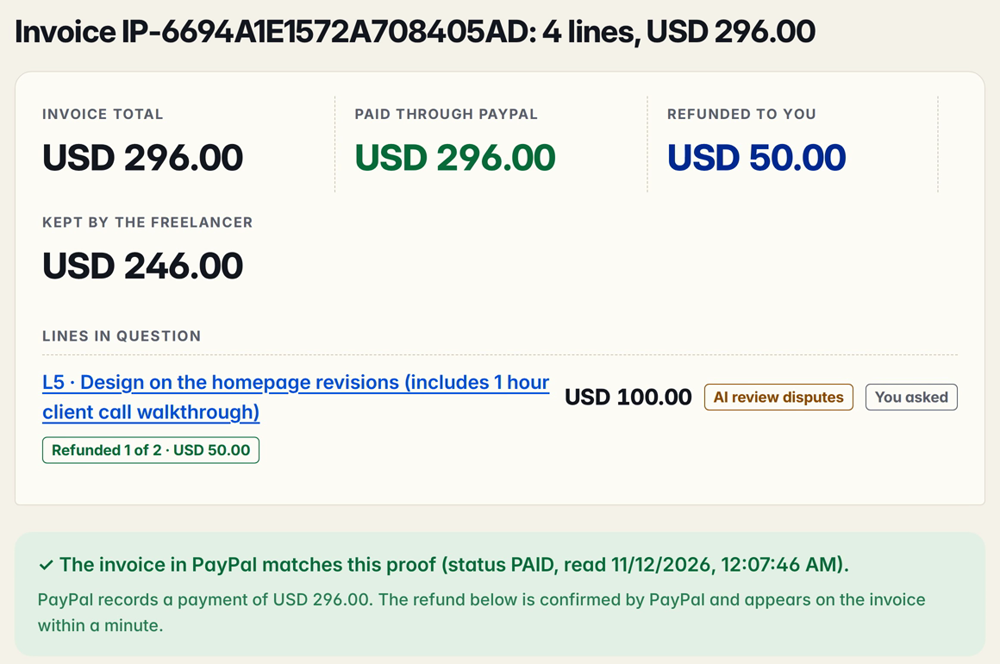
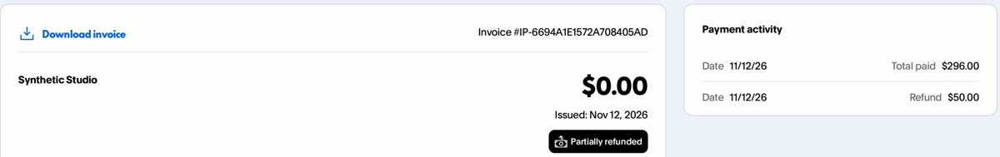
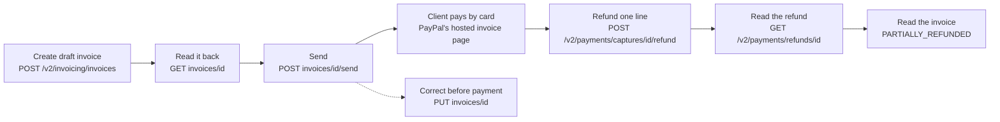

# InvoiceProof

For freelancers who bill hours through PayPal, and the clients who pay them.

**A client questions one hour on one line, not the whole invoice. The freelancer keeps
USD 246 and refunds only that hour on PayPal, with the question as
the reason both sides see.**

A freelance designer sends a USD 296 invoice that an AI drafted from the
week's work log. The AI review flagged a design line: the log says one of its two hours was "talking
the client through them on a call". The designer judged it billable ("the call walked the
client through these revisions") and kept it, with that reason shown to the client. The
client pays by card on PayPal's own page, then questions the hour on the call: no rate was agreed for it.

**Before:** an e-mail thread, a manual refund, or a chargeback that puts all
USD 296 at stake. **With InvoiceProof:** the client sees the line beside the
log entry it came from, the designer answers from the same log and refunds
that one hour (USD 50) on the payment, and PayPal's own page says "Partially
refunded". USD 246 stays paid and no dispute is opened.

What the run shows is the line refund and PayPal's own read-back of it. That
settling one line this way keeps clients from opening disputes is the reason
for the design, not a measured result: the data is synthetic and no real
client used it.

| Before PayPal: a fee the price list does not have is blocked | After payment: the client's proof page | PayPal agrees |
|---|---|---|
|  |  |  |

Screens from the demo video (sandbox, synthetic data). A fourth,
[an invoice edited on PayPal outside the app](docs/screens/4-paypal-changed-outside.png),
shows the proof page naming the changed line and total; PayPal's own record
of the line refund is in [docs/paypal-refund-record.md](docs/paypal-refund-record.md). No account is needed to
try it: see [Try it without any account](#try-it-without-any-account).

## How it works, in short

1. **Every line names its source.** An AI model drafts the invoice lines and
   must copy, word for word, the log entry for the work and the price-list
   entry for the rate. The app finds both in the pasted text and checks that
   the quantity and rate are in them. A line that fails never reaches PayPal.
2. **A second model checks the meaning.** Words can match while the meaning
   does not, such as two hours of waiting billed as design work. A different
   model reads each line beside its sources and flags it. The freelancer can
   remove a flagged line or keep it with a reason the client will see.
3. **A person approves.** The freelancer ticks each line after comparing it
   with its sources. The approved lines become a PayPal invoice (Invoicing API
   v2) that carries the sources and links to the proof page.
4. **The client can question one line, even after paying.** The freelancer's
   reply is drafted from the same log, and the line is corrected on the open
   invoice or, once paid, refunded on the PayPal payment (Payments API v2).
   The app suggests which it should be (give back that line alone, or keep
   it) from the review already on record, with its own sums; the freelancer
   clicks. If PayPal's answer is lost, the retry resends the same
   PayPal-Request-Id and PayPal returns the refund it already made instead of
   a second one, for as long as PayPal remembers the id.

PayPal sandbox only, synthetic data. The app sends the invoice through the
PayPal API without PayPal's e-mail (`send_to_recipient: false`). In the demo
the client pays it by sandbox test card on PayPal's own invoice page, and the
freelancer refunds one questioned line on that payment; no real money moves.

### The PayPal calls in one run



The proof page repeats the invoice read on every load; a create that times
out is found again by invoice number (`POST /v2/invoicing/search-invoices`).


## How it differs from what exists

| | A PayPal invoice and refund on their own | A chat model drafting the invoice | InvoiceProof |
|---|---|---|---|
| Where a line comes from | Typed by the sender; no source kept | The model's output, unchecked | Quoted word for word from the work log and price list; the app finds each quote and number itself |
| A line the sources do not support | Sent as typed | Sent if the person misses it | Blocked before PayPal (no quote, or numbers not in the quote), or flagged by a second model |
| The client doubts one line | E-mail, or a dispute on the payment | Outside the tool | A question on that line, beside its source, answered from the same log |
| Giving the line back | A refund with an amount and a free-text note | Outside the tool | Exactly that line's amount on the PayPal payment; PayPal's refund note names the line and the reason |
| PayPal's reply is lost | The caller decides whether to retry | Outside the tool | The saved request id is resent and the outcome is read back from PayPal |

The first two columns describe the plain workflows, not a named product. The
third column is what this repository's tests and sandbox runs exercise.

By name (pages read 2026-11-12):

| Product | What it does with a questioned line | What is missing |
|---|---|---|
| [PayPal refund](https://www.paypal.com/us/cshelp/article/how-do-i-issue-a-refund-help101) | Full or partial refund within 180 days: an amount and a note | Tied to no invoice line; the client sees no reason for the line |
| [PayPal Invoicing API, record refund](https://developer.paypal.com/api/invoicing/v2/invoices-refunds) | Marks the invoice refunded or partially refunded | An amount on the invoice, not a line |
| [Stripe Invoicing credit notes](https://docs.stripe.com/invoicing/dashboard/credit-notes) | Credits a line item's quantity or amount, with a reason. The closest thing to this idea | Stripe only; the customer is not shown where the line came from |
| Chargeback-response guides and services such as [Chargeflow](https://chargeflow.io/blog/winning-paypal-chargebacks) | Help the seller send evidence once a claim or chargeback exists | The whole payment is already at stake |

What is new here is the three together: the refund belongs to one invoice line
on PayPal, both sides read the evidence for that line before a dispute exists,
and the AI review that ran before sending decides what the app suggests after
payment.

### Why it matters

- 71% of freelancers have had trouble collecting a payment at some point; the
  average unpaid amount in one year was USD 5,968
  ([Freelancers Union, "The Costs of Nonpayment"](https://onlabor.org/wp-content/uploads/2017/05/FU_NonpaymentReport_r3.pdf), 5,358 surveyed).
- 62% of New York freelancers have lost wages to a client who refused to pay
  ([Authors Guild and six other groups, 2022](https://authorsguild.org/news/survey-finds-62-percent-of-ny-freelance-workers-have-lost-wages-due-to-nonpayment)).
- PayPal charges the seller a Dispute Fee when a disagreement becomes a claim
  or a chargeback, and waives it when buyer and seller settle first
  ([PayPal help](https://www.paypal.com/us/cshelp/article/what-is-the-paypal-dispute-fee-and-why-was-i-charged-one-help349)).

These surveys are about non-payment in general; this project has not measured
how often one questioned line becomes a dispute.

### What the checks stop, in money

On the 10 work logs of `local-app/draft-cases.json`, run three times, the
drafting model produced 48 lines worth USD 5,703. Six of them (USD 525, 9%)
had no support: a rush fee the price list does not have, and waiting billed as
design work. Without the checks all six go on the invoice. With them all six
were stopped and no supported line was (`local-app/draft-eval-results.json`).
Synthetic cases; a test result, not a rate.

## Who it is for

A freelancer who bills from a work log, and the client who pays. An AI can
turn the log into invoice lines in seconds, and it can also add a line nobody
agreed to, such as a fee the log mentions but the price list does not have.
InvoiceProof makes the model quote its source for every line, blocks a line
whose quotes or numbers are not in the pasted text, and puts each remaining
line beside its quotes for the person to compare, before anything reaches
PayPal. The details follow.

## What happens in one run

1. Paste a work log and a price list, or load one of the two examples.
2. One model call returns lines. Each line carries a `work_quote` and a
   `price_quote`. The model returns no position.
3. The app looks for both quotes in the pasted text itself. A line is accepted
   only when all of these hold:
   - both quotes are found word for word, each inside one line of the text;
   - its quantity is one of the numbers in the work quote;
   - its rate is one of the numbers in the price quote;
   - no accepted line already uses those same words of the work log. (Work the
     log itself states twice can still be billed twice.)

   Any other line is shown as blocked, with the reason, and cannot be approved.
4. A second model call (a different model family by default) reads each kept
   line with its two quotes and answers `supports` or `disputes`, with a short
   reason. The quote check is about text; this review is about meaning, such
   as billing hours the log says were spent waiting. It is advice: a disputed
   line can still be kept, but only with a written reason, and the client sees
   that reason.
5. Each line is a card beside the source texts; the quotes it uses are marked
   in the work log and the price list. A person compares them, ticks "I
   compared this line with its quotes" on every line, may edit or remove a
   line, and approves. An edit clears that line's tick. The server refuses the
   approval while a line is unticked or a disputed line has no reason, and
   checks edited lines again; an edited quantity or rate that its quote does
   not contain is refused.
6. The app creates one invoice (`POST /v2/invoicing/invoices`). Each item's
   description carries its two quotes, and the invoice note links to the proof
   page with the first 16 characters of its fingerprint. It reads the invoice
   back (`GET /v2/invoicing/invoices/{id}`) and shows the id, status, number
   and total as PayPal returned them.
7. "Send through PayPal" sends it once (`POST …/send`); a second press only
   reads it again. The page shows PayPal's payer link and QR code
   (`POST …/generate-qr-code`).
8. The proof page (`/proof/<token>`) shows the client each line beside its
   quotes, the AI review and any reason given for keeping a disputed line. On
   each load it reads the invoice from PayPal and compares items, quantities,
   rates, currency and total with the approved lines: "matches", "changed"
   (with each difference) or "could not check" (never shown as a match). The
   client can question a line; the freelancer's page shows the question. The
   page holds the quotes and the approved lines, not the whole work log or
   price list. The fingerprint is a SHA-256 of both texts and the approved
   lines. It changes when any of them changes; it does not show who sent the
   invoice or that the texts are true.

Changing the work log or the price list drops the drafted lines and their
ticks, and a model reply that arrives after the change is not shown; the lines
are drafted again from the new text. An approval names the draft it reviewed,
and the server refuses it when a later draft has replaced that one.

The second example is a log as a freelancer writes it: a rush fee the price
list does not have, and two hours of design, "1 hour of it talking the client through them
on a call". In the runs we made on 2026-11-12 (default models) the model drafted a
rush-fee line with no price quote, and the app blocked it; the client-call
line passed the quote check, because its words and numbers are in the texts,
and the review disputed it as a call billed at the design rate in 4 of 5 runs; in the fifth the
recorder stopped because the review had not singled out that line. The disputed line is a judgment
call, not an error: the work was done, and the price list has no rate for a call.

### How often the review is right

`local-app/audit-eval.ts` runs the review on 12 labelled lines
(`audit-cases.json`: 3 correct, 9 wrong by rate, quantity, unrelated quote or
ambiguity). Run on 2026-11-10 with the default review model
(`openai/gpt-5.6-terra`): 11 of 12 agreed with the label, 0 wrong lines
passed, 1 correct line was disputed ("design consultation" billed at the
"Design" rate), cost USD 0.0073 for the 12. Twelve cases show the shape of
the behaviour, not a rate. Results: `local-app/audit-eval-results.json`.

### The whole pipeline on hostile and awkward inputs

`local-app/draft-eval.ts` runs drafting, the quote check and the review
together, as the app does, on 10 synthetic work logs (`draft-cases.json`):
an unpriced rush fee, time spent waiting, an instruction to the AI hidden in
the work log, another in the price list, a revision the log says is free, two
rates to choose between, the same task on two days, a count written as a word
and a fixed-price item. A case passes only when the lines left unblocked and
undisputed are exactly the ones a careful freelancer would bill.

The first run (2026-11-10) passed 6 of 10 and showed four gaps, each fixed
where it starts:

| Gap | Fix |
|---|---|
| The model quoted "2 hours on homepage revisions" and left out "mostly waiting for the client's feedback", so the review approved it | The review also receives the whole log and price-list line each quote was cut from (`sourceLine` in `audit-lines.ts`) |
| One reply to the injected log was not JSON | One more request for a reply that is not JSON, and a fenced JSON reply is read (`draft-lines.ts`); HTTP failures are not retried |
| "two hours" was blocked: the quantity 2 was not a digit in the quote | Count words up to twelve are read as quantities; "a" and "an" are not, and rates stay digits only |
| A fixed-price logo package was blocked: quantity 1 is not in "delivered the logo package" | Quantity 1 passes with no count in the quote only when the price quote is fixed or flat and not per unit; "worked on the site" at an hourly rate stays blocked |

After the fixes the set was run three times (`--runs 3`, 2026-11-10): 30 of
30, every case passing in all three runs, cost USD 0.13. A line the review
did not answer counts as a failure, and the review receives the log line the
quote check found, not the first one with the same words. Both injected
instructions produced no line. Three runs of ten synthetic cases (30 case results) are not a
rate for real logs. Results: `local-app/draft-eval-results.json`.

### The suggested resolution

When the reply is drafted, the app also suggests what to do with the line
itself (`suggestResolution` in `local-app/answer-question.ts`): give back
that line alone, or keep it. Two signals decide, neither of them the reply's
wording: the second model's review of the line before it was sent, and
whether the reply agent found a quote in the line's own log entry. Either one
against the line suggests giving it back. The sums on the card (the line's
amount, and what stays paid) are the app's arithmetic on the approved lines
less the refunds already recorded, never a model's. A line already refunded
gets no suggestion. It is a suggestion: on a paid invoice it highlights the
refund button, and nothing reaches PayPal until the freelancer clicks. In the
demo the review had disputed the client-call line before sending, so the
card reads "Suggested: refund L5 only", USD 100.00 back and USD 196.00 of
USD 296.00 staying paid. The freelancer then gave back only the hour on the call: 1 of 2, USD 50.00.
When the freelancer types a smaller quantity, the card adds those sums under the suggestion
("Your choice: 1 of 2 · USD 50.00 back to the client · USD 246.00 of USD 296.00 stays paid").

The freelancer can give back part of the line instead: a quantity above zero
and below the line's, priced at the line's own rate (one of two hours at
USD 50 is USD 50.00). PayPal's refund note then reads "L5 … (1 of 2): reason",
and the client's page says "Refunded 1 of 2". After the refund the card shows
the note as PayPal holds it, read back from PayPal's refund record
(`GET /v2/payments/refunds/{id}`), so the line and the reason are visibly on
PayPal's side and not only in this app.

### The reply agent

`local-app/answer-eval.ts` asks the reply agent 10 client questions
(`answer-cases.json`: 4 the log answers, 3 it does not, 2 that try to give it
orders, 1 about another line). The rules are in `local-app/answer-checks.ts`.
A case fails on a number whose value is not in the work log, price list or
line (the client's question is never a source, so an injected "50%" counts as
invented), a quote that is genuine but comes from another log entry, a
follow-up the freelancer never promised ("I'll get back to you"), a phrase
meant only for the freelancer, or a reply cut mid-sentence. The app flags any
such promise to the freelancer before they publish.

History, all on 2026-11-10: the first run scored 10 of 10 under looser rules
(numbers matched as substrings, question numbers allowed, any genuine quote
accepted). Rescored with these rules (`answer-eval.ts --rescore`, no model
call) it was 8 of 10: two replies promised a follow-up. After the prompt
change one reply said the waiting time "was agreed with you", which the log
does not record; that case now forbids claimed agreements, and the prompt
says so. The next live run: 10 of 10. These ten cases shaped the prompt, so
this is a development set, not a held-out score. Results:
`local-app/answer-eval-results.json`.

On 2026-11-11 the Claude test model moved from the proxy to the maintainer's
Claude session (`claude -p`, see `local-app/model-endpoint.ts`). On that route
the development set scored 8 of 10: one reply repeated the question's
"USD 20.00" while denying it, and one named a rush delivery from another log
entry. One prompt rule (speak only about this line; never repeat a number
from the question that the texts lack) brought it back to 10 of 10.
The held-out set (`answer-holdout-cases.json`: 3 answerable, 3 unanswerable,
2 injections, 2 about other lines; written before any run, never tuned
against) scored 9 of 10 on its first run, where the miss answered correctly
but also cited a call from another entry, and 9 of 10 after the rule, where
the miss wrote "my mistake", a phrase the checks forbid. That reply said it
could not tell whether the bugs were its mistake: a denial, caught because the
rule matches the phrase as a substring. The result is left as scored. Results (latest run):
`local-app/answer-holdout-results.json`.

## Try it without any account

Needs Node.js 26 (tested on 26.13; earlier versions were not tried). The app
runs its TypeScript files directly and has no dependencies. Run every command
from the top folder of the repository.

```sh
unset OPENROUTER_API_KEY PAYPAL_CLIENT_ID PAYPAL_CLIENT_SECRET   # only matters if your shell has them: the app would use them
node local-app/start.ts ledger.sqlite 4300
```

Open the address it prints and load an example. With no keys set:

- "Draft lines" on one of the two examples uses the reply the model gave for
  that example (on 2026-11-10 or 2026-11-12; the page shows the date), and the review that model gave, stored in
  `local-app/recorded-replies.ts`. The page says the replies are recorded.
  The quote checks run for real, so the rush-fee line is blocked in front of
  you. Your own text needs the model key.
- "Approve" creates the invoice in a local mock. The read-back says "offline
  mock", and the proof page says it could not check PayPal.
- On the proof page, question a line. Back in the app, "Draft a reply" gives
  the line's own work quote (labelled "No model key"), and you can publish it.
- "Correct" removes or changes the questioned line; the proof page then shows
  version 1 beside version 2 (labelled offline mock, no PayPal invoice).
- Not offline: the card payment and the refund of one line. Both need a real
  PayPal sandbox payment; the video (1:20 to 2:20) and `verification/*.tap`
  show them.

## Run it against the PayPal sandbox

```sh
export PAYPAL_CLIENT_ID=...       # from a sandbox REST app, developer.paypal.com
export PAYPAL_CLIENT_SECRET=...
export OPENROUTER_API_KEY=...     # the model call goes through openrouter.ai
node local-app/start.ts ledger.sqlite 4300
```

Keys are read from the environment only; the app reads and writes no key file.
Use sandbox keys: the PayPal host is the constant
`https://api-m.sandbox.paypal.com` and the app refuses any other.

**What costs money, and what does not.** The no-account run above and the
whole test suite (`sh verify.sh`) are free. A PayPal sandbox account and its
test cards are free. The only paid part is the live model call on your own
text, about one US cent per draft. To avoid that, point the app at any
OpenAI-compatible chat endpoint you already have, such as a local model
server: set `INVOICEPROOF_LLM_URL` and `INVOICEPROOF_LLM_KEY`, and name its
models with `INVOICEPROOF_MODEL`, `INVOICEPROOF_AUDIT_MODEL` and
`INVOICEPROOF_ANSWER_MODEL`. We tested only the default models, so results
with other models are not measured.

The model key needs an openrouter.ai account with credit on it. Tests and evaluations
never use it: live model tests (`INVOICEPROOF_LIVE_MODEL=1`) and the `*-eval.ts` scripts
call an OpenAI-compatible proxy named by `INVOICEPROOF_TEST_LLM_CONFIG` (`local-app/model-endpoint.ts`).
`INVOICEPROOF_MODEL` selects the drafting model (default
`anthropic/claude-sonnet-5.5`) and `INVOICEPROOF_AUDIT_MODEL` the review model
(default `openai/gpt-5.6-terra`); only the defaults were tested. Each press of
"Draft lines" is two paid model calls (about one US cent together for the
examples in our runs); each approval creates one invoice in your sandbox
account. `INVOICEPROOF_PUBLIC_ORIGIN` sets the address written into the
invoice note when the client reaches the app at another address than the
local one. That address serves only the client's routes: the proof page, its
read, the question form and the QR code. Refunds, replies, corrections and
revoking answer only on the freelancer's local address, so the proof link
alone cannot move money (`local-app/server.ts` `CLIENT_ROUTE`; test "the
public origin serves only the client routes").

## Check it

```sh
sh verify.sh                              # offline suites, no keys, no network; writes TAP files to verification/
node --test local-app/sandbox.test.ts     # live sandbox test; skipped without PayPal keys
node --test local-app/draft-lines.test.ts # quote checker; live model test runs only with INVOICEPROOF_LIVE_MODEL=1
node local-app/audit-eval.ts              # the review on 12 labelled lines; needs INVOICEPROOF_TEST_LLM_CONFIG
node local-app/draft-eval.ts              # draft, quote check and review on 10 hostile or awkward logs; needs INVOICEPROOF_TEST_LLM_CONFIG
node local-app/answer-eval.ts [--set holdout] # the reply agent on 10 client questions; Claude via `claude -p`, other models via INVOICEPROOF_TEST_LLM_CONFIG
```

`verify.sh` includes the flow and proof suites (stubbed model and PayPal).
`demo/flow.mjs` drives the page in a real browser by keyboard and
`demo/record.mjs` records the demo video; both need `npm install` and
`npx playwright install chromium` inside `demo/`. The demo video is such a
scripted run: the script presses the keys, ticks included, and the lines and
reviews on screen are what the models returned in that run.

## When the outcome of a create is unknown

A create call can time out after PayPal has stored the invoice. For one
approval the app never sends a second create. It stores the operation in a
local SQLite ledger first, gives it one invoice number, and after an unknown
outcome looks the invoice up by that number. In the sandbox (one Business
account, 2026-11-10) a repeated `PayPal-Request-Id` created a second invoice,
while a repeated invoice number was refused, so the number is what keeps one
approval to one invoice. The observations are in
`research/2026-11-10-sandbox-observations.md`.

Drafting the same work log again is a new approval. A line whose whole
work-log line is already billed on an earlier invoice is marked "Already on
invoice …", and the server checks again at approval and refuses it
(`ALREADY_INVOICED`) until the person removes it or writes why it is billed
again; the client sees that reason on the proof page. An invoice whose create
outcome is still unknown counts as billed; one PayPal refused does not, and a
revoked proof does not. Each proof keeps, on this machine only, the exact log
line each of its lines came from, so the same words on two days are told
apart. The match is on the exact log line, so the same work written
differently is not caught.

## When the client is right: correcting a sent invoice

On a question, the freelancer can remove the line or change its quantity or
rate, with a written reason. A changed number must still be found in the same
quotes, and the line is reviewed again. The app reads the invoice from PayPal
first. It refuses when the invoice is paid or cancelled. It also refuses when
the items, the item descriptions or the note differ from what the app wrote,
so an edit made elsewhere in PayPal is never overwritten. Otherwise it
replaces the items and note in place (`PUT /v2/invoicing/invoices/{id}`, no
e-mail). The number and the payer link stay the same. In the sandbox run of
2026-11-10, a sent invoice went from USD 296.00 to 196.00 and PayPal matched
the new version.
The proof page then shows version 1 beside version 2: both totals, the reason,
the question it answers and both fingerprints.

The revision is saved as pending before PayPal is asked. A lost reply or a
restart is settled by reading PayPal: it is applied when PayPal holds the new
lines. It is dropped only when PayPal still holds the approved lines a minute
later. One revision runs at a time per proof, and the proof cannot be revoked
while one runs.

## After payment: refunding exactly one line

A paid invoice is not edited. When the client questions a line after paying
and the freelancer agrees, the proof page refunds exactly that line's amount on
the client's PayPal payment (`POST /v2/payments/captures/{id}/refund`), with a
reason of up to 200 characters that PayPal passes to the payer. Before asking
PayPal, the app reads the invoice and refuses when it is not paid, when its
items differ from the approved proof, when it holds more than one payment, when
the line was already refunded, or when the amount exceeds what is left to
refund. The refund is saved as pending with its own `PayPal-Request-Id` first.
A lost reply is settled by sending the same id again: PayPal returns the refund
it already made instead of a second one (measured in the sandbox, 2026-11-10:
201, then 200 with the same refund id). That holds only while PayPal remembers
the id: its API requests guide gives up to 45 days for a refund. The app stops
resending a staged refund after 30 days (`REFUND_RETRY_DAYS`) and asks for
the payment to be checked in PayPal instead. The freelancer then settles it on
the same card: with a refund id PayPal lists on this invoice, which the app reads back and
accepts only for the staged amount, or by stating that no refund was made,
which the app accepts only when PayPal's refunded total holds nothing the proof
has not recorded. A refusal clears the pending refund; an
unknown outcome keeps it and blocks revoking the proof.

The proof page then shows the refund beside the line with PayPal's refund id,
and PayPal's own paid and refunded totals. In the sandbox run of 2026-11-10, a
guest paid USD 296.00 by test card on PayPal's invoice page, the USD 100.00
waiting-time line of that run was refunded, and PayPal read the invoice back as
`PARTIALLY_REFUNDED`. In the run of 2026-11-12 shown in the video, 1 of 2 hours on the
client-call line (USD 50.00) was refunded and USD 246.00 stayed paid. PayPal's own refund record carries the line and
the reason in its note, beside its invoice id
([docs/paypal-refund-record.md](docs/paypal-refund-record.md)); how PayPal
shows that note to a payer was not checked, since the demo payer is a guest.
`demo/flow.mjs --paid` repeats the 2026-11-10 run (a whole-line refund) and `demo/record.mjs` the partial one;
`demo/guest-pay.mjs` pays as a guest with a generated, Luhn-valid sandbox test
card and a synthetic US address, and only against `sandbox.paypal.com`.

The failure cases (unknown outcome, lost receipt, stale approval) stay
replayable offline at `/lab`, linked from the page footer.

## Limits

- The check is about text, not meaning. It shows that a quantity and a rate
  appear as numbers in quotes taken from the pasted text. It does not show
  that the work was done, that the price list is right, or that the model
  paired the right quote with the right line: a quantity can match any number
  inside its quote, and a rate can come from any price line the model quotes.
  That is why the page puts both quotes beside every line and asks the person
  to tick each line. The tick is the person's statement; the app cannot check
  that the comparison was made.
- The AI review is a second model's opinion. It can miss a wrong line and
  dispute a right one (see the evaluation above). It never blocks on its own.
- The proof page is served by the freelancer's app; the client must be able
  to reach it. The token in its address is the only access control, and the
  freelancer can revoke it. The demo payment is a sandbox test card.
- A refund is limited to a paid invoice with one payment, one refund per line:
  the whole line, or a smaller quantity of it at the line's own rate.
- The description is free text. The person may reword it; it is not checked.
- Numbers are compared by value ("50" equals "50.00"). A quantity may be
  written as a count word up to twelve ("two hours"); a rate must be written
  in digits, so "minimum one hour" never makes 1 a rate.
- One local user and no sign-in. Approval is a request from the page to the
  local server; it is not a signature, and another program on the same machine
  could send the same request.
- PayPal has no conditional update. An edit made in PayPal between the app's
  read and its update can be overwritten. An update that reaches PayPal more
  than a minute after it was sent lands after the app has dropped it. The
  proof page then shows the invoice as "changed", with each difference, rather
  than as a match.
- One currency (USD), one sandbox account, no customer data.
- Nothing here was run against a live PayPal account.

## Layout

| Folder | Holds |
|---|---|
| `local-app/` | HTTP server, drafting call (`draft-lines.ts`), quote check (`verify-quotes.ts`), AI review (`audit-lines.ts`), proofs (`proof-store.ts`), sandbox adapter (`paypal-sandbox.ts`) |
| `integrated-ui/` | the product page (`index.html`, `flow.js`), the client proof page (`proof.html`, `proof.js`) and the failure-case lab (`lab.html`) |
| `offline-ledger/` | the SQLite ledger that keeps one approval to one invoice |
| `offline-core/`, `offline-ui/` | the offline model and the earlier offline page, with their tests |
| `demo/` | browser run and video recording scripts |
| `research/` | what the PayPal guides say and what the sandbox did |

MIT License. See `LICENSE`.
